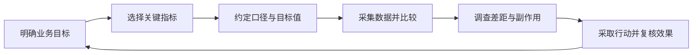

# 关键绩效指标（KPI，Key Performance Indicator）

> 姓名：王慕齐　学号：2025202116  
> 课程：2026 商业技能　词条序号：41

## 一、定义：什么是关键绩效指标

关键绩效指标（KPI）是组织围绕重要目标选定的、用于衡量目标实现程度或关键过程表现的指标。[1] 它将“经营得好不好”这样笼统的问题，转化为可以持续观察、比较和据以采取行动的证据。

例如，一家校园咖啡店希望“在保证体验的前提下提高盈利能力”，可以选择月度经营利润、订单准时交付率等 KPI。每天发了多少条朋友圈虽然也能统计，但如果不能说明它与这一目标的关系，就不应仅因容易计数而成为关键指标。

理解 KPI，要抓住三个词：

| 组成 | 含义 | 要回答的问题 |
| --- | --- | --- |
| Key：关键 | 从大量可观察信息中选出影响重要目标的少数指标 | 为什么优先看这个？ |
| Performance：绩效 | 关注工作对目标的贡献，兼顾结果与关键过程 | 它反映了什么价值？ |
| Indicator：指标 | 通过明确的测量规则提供判断依据 | 谁按什么口径测量？ |

还应区分**指标与目标值**：“订单准时交付率”是指标，“本月达到 95%”是目标值，“本月实际为 92%”是观测结果。三者配套才能判断表现，却不是同一个概念。

## 二、背景和上下文：为什么需要 KPI

企业可以记录收入、成本、浏览量、订单量、投诉数等大量数据，但管理者的注意力和资源有限。KPI 的作用，就是把日常工作与经营重点联系起来，让团队知道优先改善什么，并在偏离目标时及时发现问题。[2]

KPI 广泛用于经营分析、客户服务、生产运营、项目管理和员工绩效评价。同一指标是否“关键”，取决于具体目标：现金紧张的企业可能优先看回款与现金余额，追求稳定交付的团队可能更重视准时交付率。其他企业正在使用的指标，不能不加判断地整套照搬。

KPI 也可以嵌入平衡计分卡（BSC）等管理框架。平衡计分卡从财务、客户、内部流程、学习与成长等角度组织战略目标，有助于避免只看短期财务数字。[3] 不过，KPI 本身是一种衡量工具，并不等于完整的战略，也不必然与奖金绑定。

## 三、举例说明：校园咖啡店如何选择和使用 KPI

以下为自行构造的教学案例，所有数据与阈值均为示例，不代表真实门店业绩或行业标准。

### 3.1 先明确目标，再选指标

假设一家校园咖啡店的月度目标是：在不牺牲交付体验的前提下，改善经营利润。它选择一个主要结果指标，并搭配两个约束指标：

| 角色 | 指标 | 本月目标 | 管理用途 |
| --- | --- | --- | --- |
| 主要结果 | 月度经营利润 | 不低于 12000 元 | 判断销售增长能否留下收益 |
| 体验约束 | 订单准时交付率 | 不低于 95% | 防止接单过多导致体验恶化 |
| 质量约束 | 订单投诉率 | 不高于 2% | 防止通过压缩服务换取利润 |

这里的“约束”是指：主要指标改善时，其他重要方面也必须保持在可接受范围。三个目标不能任意互相抵消；利润超额完成，不意味着严重的质量问题可以忽略。

### 3.2 把口径写清楚

以订单准时交付率为例，一张简短的指标说明卡就能减少争议：

| 项目 | 本案例的约定 |
| --- | --- |
| 业务含义 | 检验门店是否兑现交付承诺 |
| 计算规则 | 准时交付订单数 ÷ 本期应交付有效订单数 × 100% |
| “准时”的界定 | 实际交付时间不晚于接单时确认的承诺时间 |
| 统计范围 | 承诺交付时间落在本月的已付款订单；剔除客户主动取消订单，保留门店原因取消及逾期未交付订单 |
| 数据来源 | 收银系统订单记录与交付时间记录 |
| 更新与责任 | 值班负责人每日更新，店长每周复盘 |
| 异常处理 | 未达标时按高峰时段、订单渠道和人员排班拆解 |

承诺时间在接单时留痕，不能在订单延误后改长；否则数字会变好，却无法说明交付能力有所改善。门店原因取消的订单仍保留在分母中，也能减少通过“取消难单”美化表现的空间。

### 3.3 计算与判断

假设本月有 3000 笔应交付有效订单，其中准时交付 2760 笔；这 3000 笔订单中有 90 笔发生经核实的有效投诉，每笔订单至多计一次。则：

```math
\text{准时交付率}=\frac{2760}{3000}\times100\%=92\%
```

```math
\text{订单投诉率}=\frac{90}{3000}\times100\%=3\%
```

准时交付率比目标低 3 个百分点，投诉率比目标高 1 个百分点。这里用“百分点”描述两个百分比之差，不能把 92% 到 95% 的差距表述成相对增长 3%。

再设本月确认的净销售收入为 60000 元，原料与包装等变动成本为 24000 元，房租、固定薪酬等固定经营成本为 24000 元。为便于教学，暂不考虑税费、利息及其他项目，本案例经营利润为：

```math
\text{经营利润}=60000-24000-24000=12000\text{元}
```

利润刚好达标，但两个服务指标均未达标，因此不能据此判断经营目标已经全面实现。店长应检查延误与投诉是否集中在午间高峰，再评估调整排班、优化备料或限制高峰接单量等措施。KPI 在这里提供的是调查入口；具体原因仍需订单记录与现场信息验证。

### 3.4 反例：杯数上涨，利润为什么反而下降

如果门店只考核售出杯数，员工可能依靠大幅折扣冲量。下面假设每杯原料与包装成本保持 8 元，两期固定经营成本均为 24000 元，且忽略其他变化：

| 项目 | 活动前 | 折扣活动后 |
| --- | ---: | ---: |
| 售出杯数 | 3000 杯 | 4000 杯 |
| 平均实际售价 | 20 元/杯 | 15 元/杯 |
| 单杯贡献毛利 | 12 元/杯 | 7 元/杯 |
| 贡献毛利总额 | 36000 元 | 28000 元 |
| 经营利润 | 12000 元 | 4000 元 |

其中，单杯贡献毛利等于实际售价减去单杯变动成本；经营利润等于贡献毛利总额减去固定经营成本。销量增加约 33.3%，经营利润却下降约 66.7%。

这并不证明折扣活动一定失败：若它能带来足够的后续复购，长期结果可能不同。但仅凭杯数上涨，就宣称盈利能力提高，显然缺乏依据。**指标达标不等于经营成功**，关键取决于指标是否忠实反映原来的目标。

## 四、对比分析：KPI 与相关概念有什么区别

| 概念 | 核心问题 | 咖啡店示例 | 与 KPI 的关系 |
| --- | --- | --- | --- |
| 一般业务指标（Metric） | 发生了多少、表现如何？ | 发帖数、杯数、营业时长 | 候选范围更广，只有与重要目标直接相关的部分才被选为 KPI |
| 目标值（Target） | 希望达到什么水平？ | 准时交付率不低于 95% | 是指标的预期水平，不是指标本身 |
| 目标与关键结果（OKR） | 本周期要实现什么改变，如何证明？ | O：改善高峰体验；KR：季度末准时交付率由 92% 升至 97% | 是目标管理方法，KR 可以使用 KPI 作为衡量依据 |
| 平衡计分卡（BSC） | 如何从多个维度落实战略？ | 将利润、客户体验、流程效率、人员能力联系起来 | 是组织目标与衡量指标的框架，可容纳多项 KPI |

KPI 与 OKR 不是互斥选项。同一个准时交付率，可以长期用于日常运营监控，也可以写进某季度的 KR，用来衡量一次具体改善。不能机械地说“KPI 只适合重复工作，OKR 只适合创新”，也不能把“是否关联奖金”当作两者的绝对分界。

## 五、深入扩展：怎样避免 KPI 被用错

### 5.1 结果指标与领先指标配合

结果指标反映已经发生的成果，领先指标提供对后续表现的较早信号。[1][2] 在咖啡店中，月度利润能说明最终赚了多少，高峰前备料完成率则可能帮助提前发现交付风险。

“领先”是相对于某个结果而言的，不能仅凭时间上先发生就认定其有效。备料完成率提高是否真的改善准时交付，还需要历史数据与实际试验支持；即使存在相关性，也不自动构成因果关系。

### 5.2 指标应能支持决策

选择 KPI 时，可以依次检查：它是否对应重要目标，能否稳定测量，数据获取成本是否合理，负责人能否通过行动影响它，以及它改善时是否可能损害其他目标。

例如，“客服平均处理时长”很容易统计，但若单独用于考核，可能诱使客服过早结束对话。把它与首次解决率、重复求助率一起观察，才能区分效率提升与服务缩水。对于研究、创意等难以即时量化的工作，也应结合同行评价、里程碑及长期成果，避免把容易统计的活动数量当成全部价值。

### 5.3 不存在通用的 KPI 评分公式

KPI 是指标类别，并没有一个适用于全部场景的统一计算公式。收入、缺陷率、交付时长各有不同定义，“实际值 ÷ 目标值”只是特定条件下的一种达成率写法。

对于目标值为正、且越大越好的数量指标，可以约定：

```math
r=\frac{x}{T}\times100\%,\qquad T>0
```

其中 `x` 为实际值，`T` 为目标值。但对投诉率这种越小越好的指标，直接套用就会出现“投诉越多，达成率越高”的错误。目标为零时，该比值还无法计算。此时可直接报告实际值、目标值与差距，或事先制定适合该指标的分档规则。

若组织确需综合评分，可在各指标已经按约定规则转换为可比较分数后加权：

```math
S=\sum_{i=1}^{n}w_i s_i,\qquad w_i\geq0,\quad\sum_{i=1}^{n}w_i=1
```

其中 `s_i` 是第 `i` 个指标的标准化分数，`w_i` 是权重。不能直接把“12000 元”“92%”“3%”相加。权重、评分尺度和必要的底线条件都需要明确；一个综合分数无法替代对各项业务表现的解释。

### 5.4 警惕总体平均值掩盖问题

假设普通订单的准时交付率为 98%，复杂订单为 80%，总体准时交付率会随着两类订单的占比变化。即使两个类别内部都没有改善，只要普通订单占比提高，总体数字也可能上升。

因此，跨期比较时应检查统计口径、订单结构与样本规模。必要时按渠道、时段或订单类型拆分，不能只看一个总体平均数就宣布流程进步。

### 5.5 从观察走向改进

KPI 的运作可以概括为以下闭环：



复盘时既要问“为什么没达标”，也要问“达标之后，原来的问题真的改善了吗”。如果指标已不能解释业务，应该透明记录原因、修订口径或更换指标，而不是在结果不理想时悄悄改分母、删异常值。

## 六、简明总结

KPI 是衡量重要目标及关键过程表现的指标，其价值在于帮助组织聚焦、判断和改进。用好它，需要把目标、指标、目标值和实际结果分清，写明统计口径、负责人及复盘方式，并兼顾结果、过程与必要约束。

咖啡店案例说明，销量上涨不一定增加利润，利润达标也不一定意味着服务目标实现。评价 KPI 的最后一道检验应当是：数字变好时，组织想实现的价值是否也随之改善。

## 参考资料

[1] KPI.org（Balanced Scorecard Institute）. [What is a Key Performance Indicator (KPI)?](https://www.kpi.org/kpi-basics/). 用于定义、领先与滞后指标及指标与目标值的区分。

[2] Microsoft Learn. [Using key performance indicators (KPIs) to meet your business goals](https://learn.microsoft.com/en-us/dynamics365/business-central/analytics-about-kpis). 用于目标对齐、负责人、监测频率与常见使用误区。

[3] Balanced Scorecard Institute. [Balanced Scorecard Basics](https://balancedscorecard.org/bsc-basics-overview/). 用于平衡计分卡及其与战略衡量的关系。

以上网页访问日期：2026 年 10 月 17 日。本文的校园咖啡店、客服及订单结构示例均为教学构造；计算、比较和管理判断由本文在所列假设下展开。
