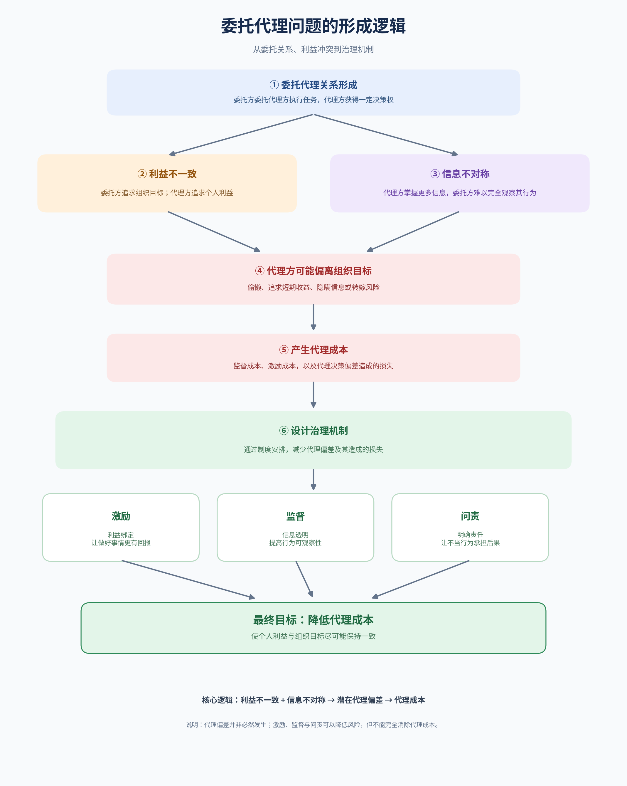

# 激励机制与委托代理问题

## 一、名词定义

1\. 激励机制

激励机制是指组织通过设计奖励、惩罚、考核和责任规则，影响个人的行为选择，使个人更愿意采取符合组织目标的行动。

2\. 委托代理问题

委托代理问题是指：一个人或组织委托另一个人替自己做事，但双方利益不完全一致，而且委托方通常无法完全观察代理方的行为，因此代理方可能优先考虑自己的利益，而不是委托方的利益。

## 二、背景与应用场景

在经济学中，委托代理理论主要研究：当决策权、执行权和利益归属分散在不同主体之间时，应该如何设计契约和管理规则。

### 委托代理问题的形成逻辑

这种问题广泛存在于企业治理、劳动关系、公共管理以及金融服务等场景。

## 三、举例说明：公司为什么要给经理人发奖金？

假设一家公司的股东聘请经理人经营企业。

- 股东的目标：提高企业长期价值。
- 经理人的目标：获得更高收入、减少工作压力、保持职位稳定。
- 信息差异：经理人比股东更了解企业的日常经营情况。

如果经理人的工资完全固定，而且股东难以观察其努力程度，经理人就可能缺乏额外努力的动力。

如果公司只按照当年利润发奖金，经理人又可能通过削减研发投入、推迟必要支出等方式提高短期利润，却损害企业的长期发展。

因此，公司可以组合使用以下机制：

| 管理措施 | 具体做法         | 解决什么问题       |
| ---- | ------------ | ------------ |
| 激励   | 奖金与经营成果挂钩    | 让努力与个人收益相关   |
| 长期激励 | 股票、长期绩效奖励    | 减少对短期业绩的过度追求 |
| 监督   | 审计、经营报告、绩效检查 | 降低信息不对称      |
| 责任安排 | 明确职责、违规追责    | 提高偏离组织目标的成本  |

这些措施的关键不在于单纯提高奖金，而在于让奖励对应真正有价值的成果，同时防止代理方为了自身收益损害组织利益。

## 四、对比分析：激励、监督与问责有什么区别？

### 激励：让人愿意做

通过奖金、晋升、分红等方式，使符合组织目标的行为更有吸引力。

### 监督：让行为更可观察

通过审计、信息披露和绩效追踪，减少代理方隐瞒行为或信息的空间。

### 问责：让偏差有相应后果

通过明确责任、处罚和追偿规则，增加不当行为的成本。

三者相互补充，但也有局限：

- 过度依赖奖金，可能导致员工只追求考核指标，忽视难以量化的工作。
- 过度监督，可能增加管理成本，削弱信任与创造力。
- 责任划分不清，即使有奖励和处罚，也可能出现推诿责任的情况。

因此，良好的机制需要在激励效果、监督成本和个人自主性之间取得平衡。

## 五、深入扩展：为什么信息不对称很重要？

委托代理问题通常与两类信息不对称有关。

### 事前：逆向选择
委托方在签订合同或选择代理人时，不完全了解对方的真实能力、类型或风险。
例子： 企业招聘时无法准确判断候选人的真实能力，可能招到不合适的人。

### 事后：道德风险
合同签订后，代理方的行为或努力程度难以被完全观察，可能因此采取对自己有利、但对委托方不利的行动。
例子： 员工领取固定工资后，管理者难以观察其实际努力程度，员工可能减少投入。

这也说明，激励机制不能只关注“做得好就奖励”，还需要考虑两个问题：

1. 激励相容： 让代理方在追求自身利益时，也愿意选择委托方希望的行动。
2. 参与约束： 给代理方的报酬和工作条件需要具有足够吸引力，使其愿意接受委托安排。

理想情况下，组织不必时时刻刻监督代理人，而是通过合理的契约设计，让代理人主动做出符合组织目标的选择。

## 六、简明总结

委托代理问题是利益不一致与信息不对称导致的治理难题；激励机制则通过奖励设计、监督安排和责任约束，尽可能使代理方的个人利益与委托方的组织目标相协调。
但激励机制无法保证所有人的利益完全一致，也无法彻底消除代理成本。它的目标是在现实约束下，降低利益冲突造成的损失。

参考资料：

- 维基百科：[Principal–agent problem（委托代理问题）](https://en.wikipedia.org/wiki/Principal%E2%80%93agent_problem?utm_source=chatgpt.com)
- 维基百科：[Incentive（激励）](https://en.wikipedia.org/wiki/Incentive?utm_source=chatgpt.com)
- 维基百科：[Mechanism design（机制设计）](https://en.wikipedia.org/wiki/Mechanism_design?utm_source=chatgpt.com)
